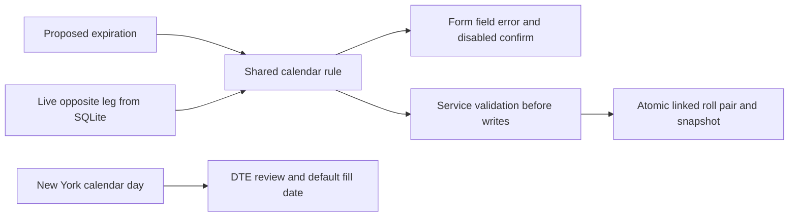

# US-102 — Shared PMCC expiration safety

Requirements: [OPT-11](https://linear.app/optionswheel/issue/OPT-11).
Implementation plan: [us-102](../plans/us-102/plan.md).

The shared PMCC coverage rule now compares parsed calendar dates using date-fns.
A short must expire strictly before its covering LEAPS; equality, inversion and
invalid parsed dates cannot establish coverage. Existing entry and roll consumers
reuse this one comparator and their established directional field messages.

Both roll sheets default their review date and fill date to the New York calendar
day through `newYorkToday`. An explicit `today` still overrides it for deterministic
reviews. Coverage validation compares expirations independently of the displayed
DTE. Existing entry and classic-wheel date defaults are preserved.

## Implementation

| File                                                     | Change                                                                                                         |
| -------------------------------------------------------- | -------------------------------------------------------------------------------------------------------------- |
| `src/main/core/pmcc-rules.ts`                            | Calendar comparison through `isBefore(parseISO(short), parseISO(long))`; stable signature, codes and messages. |
| `src/renderer/src/lib/dates.ts`                          | Native Intl adapter with explicit `America/New_York` date parts.                                               |
| `src/renderer/src/components/RollPmccShortCallSheet.tsx` | New York default valuation/fill date.                                                                          |
| `src/renderer/src/components/RollPmccLeapsSheet.tsx`     | Same New York default, retaining date injection.                                                               |

Both services already read the live opposite leg and validate before the shared
transaction writes the linked close/open pair and snapshot. New regressions prove
that behavior after preceding opposite-leg rolls, including complete unchanged
state on rejection. Registered-handler tests exercise real services through
`handleIpcCall`; no new IPC surface, migration, dependency or production type was
needed. Existing `FormButton` disabled styling and draft/error routing were already
correct and are covered by stronger tests.

## Verification

- Full Node 22 unit/integration suite: 288 files, 4,633 tests passed normally and
  with coverage. All four changed production files have 100% line and branch coverage.
- New comparator/lifecycle properties use independent UTC chronology; three seeds
  each passed 500 runs. Calendar examples include invalid dates and leap-day boundaries.
- Date/sheet regressions run under UTC and cover the New York day boundary, year
  boundary and DST transitions. Injected reviews verify 158, 494 and 67 DTE arithmetic.
- Electron verification across all 42 suites: 479 passed, one pre-existing TODO.
  All nine current-workflow US-102 cases pass with full distinct names in
  `e2e/pmcc-expiration-safety.spec.ts`. The targeted entry/roll run passed 76 cases.
- Lint and typecheck are clean. Cold review found zero blocking or advisory findings.

Verification also exposed an existing scheduler E2E timing assumption: its counter
included ticks during app startup. The test now checks additional ticks over its
measured observation window; all 13 scheduler cases pass. An unrelated IV-staleness
startup timeout passed its isolated retry. These results are combined with the
completed suites; the first broad invocation did not finish cleanly in one run.

The local Node 24 runtime triggered an existing native SQLite cleanup assertion.
Checks use the installed Node 22 runtime and its matching SQLite ABI. Rebuild for
Electron before launching the app or its E2Es, as documented in the repository.

## Completion boundary

This delivers the shared prerequisite and existing-roll coverage. The three S5/S6
subsequent-short workflow cases remain owned by
[US-115 / OPT-23](https://linear.app/optionswheel/issue/OPT-23). That consumer must
reuse the live LEAPS, comparator and short-side message and prove real form/service
recording, rejection without writes, retained drafts and its fixed-date review.
Full cross-story acceptance remains open until those workflows run; no skipped
placeholder or simulated successful workflow was added here.
