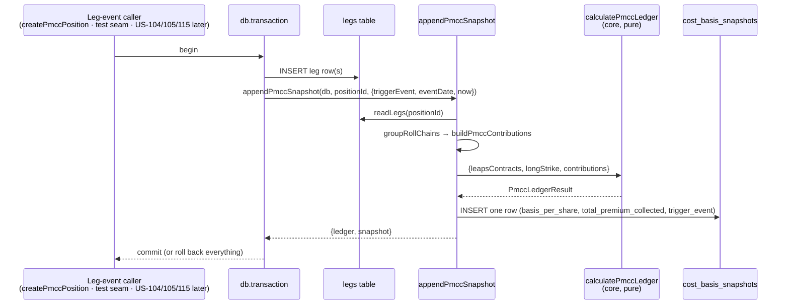

# US-103 — Calculate and display PMCC cost basis

Adds the running PMCC cost-basis ledger: a pure engine over signed per-share contributions, one
service-layer snapshot writer that every PMCC leg event calls inside its own transaction, a shared
roll-chain helper extracted from the assignment service, the `Cost basis` drawer on the PMCC detail
page, and the running total on the PMCC list row. A classic wheel's detail page, list row and
services are unchanged.

Plan: `plans/us-103/plan.md` · Story: Linear
[OPT-9](https://linear.app/optionswheel/issue/OPT-9/us-103-calculate-and-display-pmcc-cost-basis) ·
Type design: `plans/us-103/data-model.md` · Contracts: `plans/us-103/contracts/`

## Why

A PMCC has no shares and no assignment strike, so the wheel formula
(`assignment_strike − premiums`) does not apply. What a PMCC trader tracks is the running net cost of
the long call: the LEAPS debit, reduced by every short-call credit, adjusted by the net cash of every
roll. US-101 showed that figure once at entry; this story makes it a running ledger that is
recalculated after every leg event and stored as an auditable snapshot chain.

## The formula

Cost basis is a **cash ledger of recorded fills**. It never depends on a quote.

```
contribution (dollars) = sign(side) × (cashPerShare × contracts × 100) + fees
   LONG  side: BUY +cash, SELL −cash               (LEAPS legs)
   SHORT side: SELL −cash, BUY +cash               (short-call legs)
   EXPIRE / ASSIGN / EXERCISE: cash 0, fees still count
   a roll chain is ONE contribution: Σ BUY − Σ SELL across its two legs

leapsCostTotal     = Σ LONG contributions
shortCreditsTotal  = −Σ SHORT contributions
basisTotal         = leapsCostTotal − shortCreditsTotal
basisPerShare      = basisTotal ÷ (leapsContracts × 100)
effectiveShareCost = current long strike + basisPerShare      (null without an open long)
premiumRecovered % = shortCreditsTotal ÷ leapsCostTotal × 100  (null when leapsCostTotal ≤ 0)
```

Two rules that matter: a LEAPS roll takes **no** strike-delta term (the strike change is already in
the roll's cash and shows up through `effectiveShareCost`), and a negative basis is a real, signed
figure that is never clamped.

## What changed

### Core engine — `src/main/core/costbasis.ts`

`calculatePmccLedger({ leapsContracts, longStrike, contributions })` folds the contributions above
and returns `PmccLedgerResult` (eight 4-dp strings, two nullable). It knows nothing about legs,
roles or storage. Property tests in `costbasis.property.test.ts` pin an independent oracle,
`basisTotal = leapsCostTotal − shortCreditsTotal`, order independence, contract-scale invariance and
the two null guards.

### Enums — `src/main/core/types.ts`, `src/main/schemas.ts`

`LegRole` gains `LEAPS_CLOSE`, `SHORT_CALL_CLOSE`, `SHORT_CALL_EXPIRED`, `SHORT_CALL_ASSIGNED`.
`PmccLegRole` and `isPmccLegRole` derive from one `PMCC_LEG_ROLE_VALUES` list. `PmccTriggerEvent`
is a Zod enum of the six `PMCC_*` events and `TriggerEvent` is the union with the wheel's eight. No
migration: `leg_role` and `trigger_event` carry no CHECK constraint and `basis_per_share` is TEXT.

### Service layer

| File                               | Role                                                                                                                                                                                                     |
| ---------------------------------- | -------------------------------------------------------------------------------------------------------------------------------------------------------------------------------------------------------- |
| `services/pmcc-ledger.ts`          | `buildPmccContributions` (legs → signed contributions, roll chains collapsed, unknown roles dropped with a WARN), `pmccLedgerFromLegs`, and **`appendPmccSnapshot`** — the one writer of PMCC snapshots. |
| `services/roll-chains.ts`          | `groupRollChains(legs)` — groups `ROLL_FROM`/`ROLL_TO` by `rollChainId`, nets `Σ SELL − Σ BUY`. Extracted from `assign-csp-position.ts`, which now consumes it; the assignment waterfall is unchanged.   |
| `services/leg-rows.ts`             | `readLegs(db, id)` and `readLegsByPosition(db, ids)` — the shared legs reader (moved out of `get-position.ts`).                                                                                          |
| `services/pmcc-opening-legs.ts`    | Pure selectors over `LegRecord[]`: `pmccEntryLegs` (first opening legs → `initialNetDebit`), `pmccOpeningLegs` (later rows win → list leg summaries).                                                    |
| `services/create-pmcc-position.ts` | Writes its `PMCC_OPEN` snapshot through `appendPmccSnapshot` instead of local arithmetic; the response is unchanged.                                                                                     |
| `services/get-position.ts`         | `GetPositionResult.pmccLedger: PmccLedgerResult \| null`, computed from the legs it already reads.                                                                                                       |
| `services/list-positions.ts`       | `PmccListSummary` carries `basisPerShare` / `basisTotal` from the ledger; `initialNetDebit` is gone.                                                                                                     |

`appendPmccSnapshot` deliberately opens **no transaction of its own**. The caller wraps the leg
insert and the snapshot in one `db.transaction`, so a storage failure leaves neither a leg nor a
snapshot. The snapshot row stores `basis_per_share`, `total_premium_collected = shortCreditsTotal`,
`final_pnl NULL`, the `PMCC_*` trigger and `snapshot_at = makeSnapshotAt(eventDate)`.

### Dev-only test seam — `src/main/ipc/test-pmcc-ledger.ts`

`_test:pmcc-record-leg-event` (registered only under `NODE_ENV === 'test'`, exposed as
`window.api.testPmccRecordLegEvent`) inserts the given PMCC leg rows and appends the snapshot in one
transaction. It lets the e2e suite land expirations, subsequent shorts and rolls before US-104, 105,
111 and 115 record them in production. Its payload is typed end to end from
`TestPmccLegEventPayloadSchema`.

### Renderer

- `PmccCostBasis` — a `CollapsedDrawer` titled `Cost basis`, open by default, captioned
  `US-103 · cash ledger, never a quote`, with six `StatGrid` cells: Cost basis / share (sky), Total,
  LEAPS cost to date, Short-call credits to date (shown negated, neutral colour), Effective share
  cost, Premium recovered (`fmtPct1`, half-up to one decimal). All money cells format through
  `fmtMoneyGrouped`, which rounds with Decimal `ROUND_HALF_UP`, so a half-cent basis agrees with its
  total.
- `PositionCockpit` PMCC branch stacks `PmccLegReference` then `PmccCostBasis`; the wheel branches
  are untouched.
- `PmccPositionRow` renders the running `basisTotal` in its last cell with no "net debit" suffix.

## Data flow



Read paths recompute from legs rather than trusting the snapshot: `positions:get` returns
`pmccLedger` for the drawer, `positions:list` returns `basisPerShare` / `basisTotal` for the row, and
`allSnapshots` remains the audit chain.

## Recorded decisions and limitations

- **List leg summaries are not roll-aware.** `pmcc.long` / `pmcc.short` keep US-101's "later `*_OPEN`
  row wins" rule; `ROLL_TO` legs are not consulted. The cost-basis cells are correct. Roll-aware
  summaries belong to US-104/105, which record rolls in production
  (`plans/us-103/area-7-green-results.md`).
- **Failed-write e2e uses an SQLite abort trigger**, not `chmod`: an open connection ignores later
  permission changes (existing US-101 ADR).
- **The drawer caption contains the story ID** because the Linear story's UI section asks for it.
  Worth a product decision before this reaches a trader.
- `fmtMoney` in `lib/format.ts` still rounds through `parseFloat`; the wheel surfaces that use it can
  show a half-cent value one cent low. Out of scope here.

## Verification

- `pnpm test` — 263 files, 3929 tests · `pnpm lint` · `pnpm typecheck` all clean.
- `pnpm test:e2e` — 39 files, 443 tests; `e2e/pmcc-cost-basis.spec.ts` has one `it` per Linear
  scenario (13), named after the Gherkin.
- Coverage ≥ 95% lines and branches on every changed production file except
  `src/renderer/src/api/positions.ts`, where the only change is a type-only re-export (no executable
  lines; pre-existing 45% baseline).
