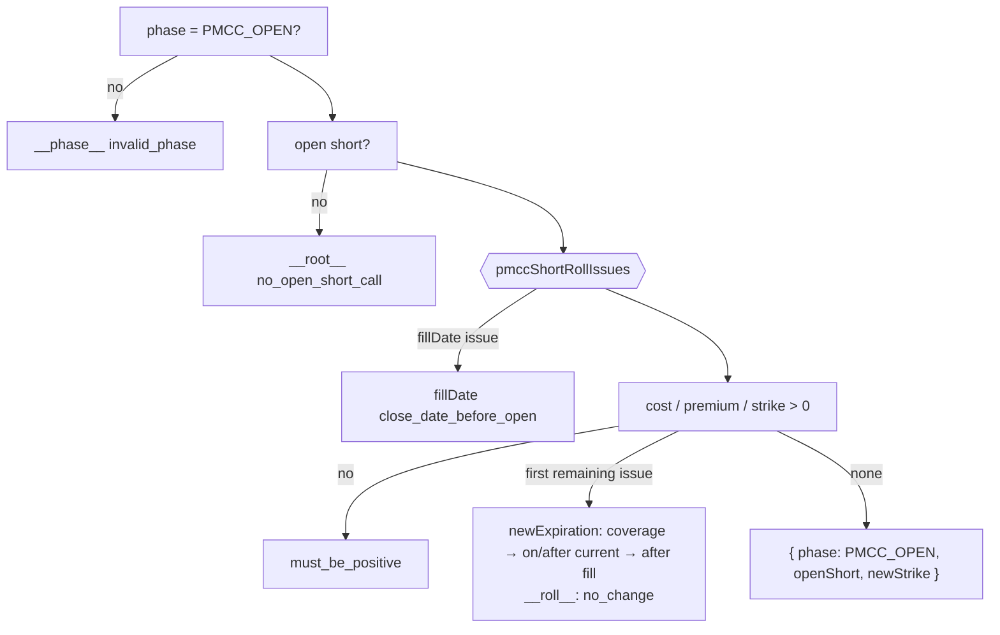
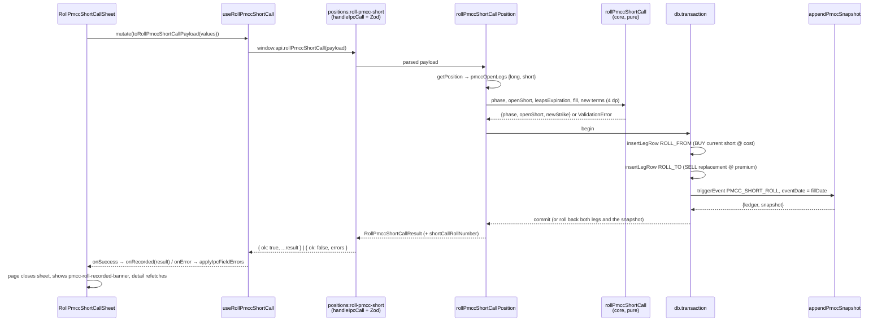

# US-104 — Roll the PMCC short call with net credit/debit preview

Adds the PMCC short-call roll. It has four parts. A pure `rollPmccShortCall` rule set checks that
the replacement is a legal successor. A service writes the linked `ROLL_FROM` BUY / `ROLL_TO` SELL
pair and US-103's `PMCC_SHORT_ROLL` snapshot in one transaction. A new `positions:roll-pmcc-short`
channel carries the request. A `Roll Short Call` sheet shows a coverage ruler, a live net
debit/credit preview, the post-roll basis and an advisory below-effective-cost warning. The classic
wheel's covered-call roll is unchanged.

Plan: `plans/us-104/plan.md` · Story: Linear
[OPT-12](https://linear.app/optionswheel/issue/OPT-12/us-104-roll-the-pmcc-short-call-with-net-creditdebit-preview) ·
Type design: `plans/us-104/data-model.md` · Contracts: `plans/us-104/contracts/` · Layout of record:
`mockups/epic-09-pmcc-position-detail.mdx` (`RollShortSheet`)

## Why

A PMCC trader rolls the short call often, to dodge assignment or to collect more time value. Each
roll closes one short and sells another, and the net cash of the pair moves the running cost basis.
Before this story the only way to record that was US-103's test seam. Now the trader enters the
cost to close and the new contract, sees the net and its effect on basis before confirming, and the
app stores the roll as one linked pair and one ledger line. Two kinds of mistake get stopped: a
replacement that would outlast the LEAPS (a naked short) and a "roll" that changes nothing.

## Behaviour

- **Entry point.** A `Roll Short Call →` header action (`roll-pmcc-short-btn`) appears on a PMCC
  detail page only while a short call is open. A LEAPS-only PMCC has no button. The wheel's header
  buttons are unchanged.
- **Context.** The sheet opens with `Coverage` (today, the current short, the replacement and the
  LEAPS on one axis) and `Current short call` (contract, expiration with DTE, `Sold at`, the
  read-only LEAPS, and `Effective share cost` with a "not a guaranteed breakeven" note).
- **Inputs.** Cost to close / share, premium / share, strike, expiration with a live `N DTE` hint,
  and fill date (defaults to today). Contracts are read-only, because partial rolls are out of scope.
- **Live preview.** Until both cash fields parse, a dashed placeholder reads `Enter a cost to close
and a premium to preview the net.` After that the `Net` card shows `Net Debit: $0.60 per share
($60.00 total)` in red or `Net Credit: $1.20 per share ($120.00 total)` in green. Below it are the
  roll label (`Roll Up & Out: $108 to $112 strike, Nov to Dec expiration · 42 DTE`; across a year
  end the months carry years, `Nov 2026 to Nov 2027`), `Cost basis
after roll` and `Effective share cost after roll`. Both cost rows show the "from" figure.
- **Advisory warning.** When the new strike is below the post-roll effective share cost, an
  `AlertBox warning` says so and estimates the per-share loss if assigned. Confirm stays enabled.
- **Rejections.** Each message appears next to its field (or in the no-change alert) and confirm is
  disabled. When the replacement reaches the LEAPS, the ruler turns red and the footer says the
  current short stays open. The same rules run again in the engine, so a direct IPC call is rejected
  with the same text.
- **Success.** The sheet closes. A `pmcc-roll-recorded-banner` above the cockpit names both legs and
  the ledger line: `Short-call roll #1 debit · $0.60 per share ($60.00 total). Both legs share one
roll chain.` TanStack invalidation refetches the detail, so the `Cost basis` drawer reads $21.80
  and the `Leg reference` shows the $112 short. Opening the sheet again clears the banner.
- **Wheel CC roll unaffected.** `rollCc`, `RollCcSheet` and the `roll-cc-btn` path are unchanged. An
  e2e regression test confirms the CC roll sheet has no LEAPS or effective-cost content.

## The rule set

`rollPmccShortCall` in `src/main/core/lifecycle.ts` checks ten rules in a fixed order. The first
failure throws `ValidationError(field, code, message)`.

| #   | Rule                                      | field                    | code                          | Shared? |
| --- | ----------------------------------------- | ------------------------ | ----------------------------- | ------- |
| 1   | phase is `PMCC_OPEN`                      | `__phase__`              | `invalid_phase`               | engine  |
| 2   | a short call is open                      | `__root__`               | `no_open_short_call`          | engine  |
| 3   | roll fill ≥ open short's fill             | `fillDate`               | `close_date_before_open`      | ✔       |
| 4   | cost to close > 0                         | `costToClosePerContract` | `must_be_positive`            | engine  |
| 5   | replacement premium > 0                   | `newPremiumPerContract`  | `must_be_positive`            | engine  |
| 6   | new strike > 0                            | `newStrike`              | `must_be_positive`            | engine  |
| 7   | replacement expires before the LEAPS      | `newExpiration`          | `short_not_before_long`       | ✔       |
| 8   | replacement ≥ current expiration          | `newExpiration`          | `must_be_on_or_after_current` | ✔       |
| 9   | replacement expires after the roll fill   | `newExpiration`          | `expiration_not_after_fill`   | ✔       |
| 10  | strike or expiration changes (Decimal eq) | `__roll__`               | `no_change`                   | ✔       |

The five "shared" rules (3, 7–10) are defined once, in `pmccShortRollIssues` in
`src/main/core/pmcc-rules.ts`. That pure function returns every broken rule in order. The engine and
the renderer's form schema both use it:

- **Engine:** throws a rule-3 issue before checking money, then any other issue after rule 6.
- **Renderer** (`schemas/roll-pmcc-short-call.ts`): its `superRefine` passes in only the values the
  trader has finished entering. An incomplete date or strike is `undefined`, and rules that read it
  are skipped. It then reports the first issue for each path.

Two messages are shared constants. `SHORT_NOT_BEFORE_LONG` (the short-side half of US-102's
comparator, also used by `openPmcc`) and `EXPIRATION_NOT_AFTER_FILL` (shared with `openPmcc`'s
per-leg rule) mean the message text has one home and cannot drift between the engine, the form and
PMCC entry.

## What changed

### Core — `src/main/core/`

| File                                   | Change                                                                                                                                                                                                                 |
| -------------------------------------- | ---------------------------------------------------------------------------------------------------------------------------------------------------------------------------------------------------------------------- |
| `pmcc-rules.ts`                        | `SHORT_NOT_BEFORE_LONG`, `EXPIRATION_NOT_AFTER_FILL`, `shortExpiresBeforeLeaps`, `pmccShortRollIssues`, `PmccShortRollContext`/`Input`/`Field`. `PmccIssue<F>` is generic. `issueIf` takes a `{ code, message }` rule. |
| `lifecycle.ts`                         | `PmccShortCallTerms`, generic `RollPmccShortCallInput<S>` / `RollPmccShortCallResult<S>`, `rollPmccShortCall`. `throwIssue` replaces the inline rethrow in `openPmcc`.                                                 |
| `*.property.test.ts`, `arbitraries.ts` | New `pmcc-rules.property.test.ts`. The phase-guard table and four roll properties (coverage, legal successor, expiry ≤ fill, fill before open) are added. New `strictlyOrderedDays` generator.                         |

### Services — `src/main/services/`

| File                               | Change                                                                                                                                                                                                                            |
| ---------------------------------- | --------------------------------------------------------------------------------------------------------------------------------------------------------------------------------------------------------------------------------- |
| `roll-pmcc-short-call-position.ts` | **New.** `getPosition` → `pmccOpenLegs` → engine → one `db.transaction` (two `insertLegRow` + `appendPmccSnapshot('PMCC_SHORT_ROLL')`). Legs write `fees '0.0000'`. The position row is untouched. Returns `shortCallRollNumber`. |
| `pmcc-ledger.ts`                   | `orderedLedgerEvents` (legs + roll chains, fill-then-created order) drives `contributionsFrom`, `currentLeapsLeg` (was `newestLongBuy`) and the new `currentShortCallLeg`. Also adds `pmccOpenLegs` and `PmccOpenLegs`.           |
| `leg-rows.ts`                      | `insertLegRow(db, LegRecord)`, the inverse of `readLegs`.                                                                                                                                                                         |
| `get-position.ts`                  | Adds `GetPositionResult.pmccOpenLegs` (null for a wheel).                                                                                                                                                                         |
| `create-pmcc-position.ts`          | Uses `insertLegRow` instead of its private INSERT.                                                                                                                                                                                |
| `test-fixtures/pmcc-legs.ts`       | Uses `insertLegRow`. Gains the shared `pmccOpenPayload` / `recordPmccLegEvent` helpers.                                                                                                                                           |

### Schemas, IPC, preload

- `src/main/schemas.ts`: `RollPmccShortCallPayloadSchema` is `RollPayloadBaseSchema` with `fillDate`
  tightened to ISO. `RollResultBase<Phase>` now owns the `position` block, so `RollCspResult` and
  `RollCcResult` become aliases, and `RollPmccShortCallResult` adds `ledger`, a narrowed
  `costBasisSnapshot` and `shortCallRollNumber`. `GetPositionResult` also gains `pmccOpenLegs`.
- `src/main/ipc/positions.ts`: adds one `registerParsedPositionHandler` for `positions:roll-pmcc-short`.
- `src/main/ipc/test-pmcc-ledger.ts`: the US-103 seam now builds a `LegRecord` and calls
  `insertLegRow`.
- `src/preload/index.ts` / `index.d.ts`: `rollPmccShortCall`, `IpcRollPmccShortCallResult`.

### Renderer

| Layer      | Files                                                                                                                                                                                                                                                                                                                                                                                                                                                                     |
| ---------- | ------------------------------------------------------------------------------------------------------------------------------------------------------------------------------------------------------------------------------------------------------------------------------------------------------------------------------------------------------------------------------------------------------------------------------------------------------------------------- |
| api        | `api/positions.ts`: `rollPmccShortCall`, `RollPmccShortCallPayload` / `Response`, and a re-export of `PmccOpenLegs`. `api/error.ts`: adds `ipcFieldErrorsOf` (a type-guarded read of a 400's `detail`).                                                                                                                                                                                                                                                                   |
| hooks      | `useRollPmccShortCall` (over `usePositionMutation`) and `useRollPmccShortCallForm` (RHF, `mode: 'onChange'`, zod resolver, empty defaults). The form hook returns `{ methods, schema }`, so the form judges `valid` with the one schema it resolves with.                                                                                                                                                                                                                 |
| lib        | `lib/pmcc-roll.ts`: `pmccRollNet`, `pmccRollLabel`, `pmccPostRollEffectiveCost`, `pmccStrikeShortfall`, all with Decimal half-up math. `pmccPostRollEffectiveCost` runs the core `calculatePmccLedger` (the basis so far as one LEAPS-share contribution plus the roll's net on the short's contracts), so a short on fewer contracts than the LEAPS is spread over every LEAPS share. `lib/ipc-field-errors.ts`: `applyIpcFieldErrors`, now shared with `PmccEntryForm`. |
| schemas    | `schemas/roll-pmcc-short-call.ts` (new). `schemas/common.ts` gains `moneySchema` and `inputToNumber`, moved out of `pmcc-entry.ts`.                                                                                                                                                                                                                                                                                                                                       |
| components | New: `RollPmccShortCallSheet` (portal, dialog, mutation, error routing), `RollPmccShortCallForm`, `RollPmccShortCallFields`, `PmccCoverageRuler`, `PmccRollNetPreview`, `PmccRollRecordedBanner`. Changed: `PositionDetailActions` (`Roll Short Call →`), `FormButton` (disabled dimming), `PmccLegReference` / `PositionCockpit` (open legs).                                                                                                                            |
| pages      | `usePositionDetailSheets` adds sheet and banner state, and `overlayOpen` now includes the new sheet. `PositionDetailPage` mounts the banner and the sheet.                                                                                                                                                                                                                                                                                                                |

### E2E — `e2e/`

`pmcc-short-call-roll.spec.ts` has one `it` per Linear scenario, including each Scenario Outline row
(12 in total). `pmcc-roll-helpers.ts` reaches the US-103 Background (XYZ, $108 short at $1.80 over
the $80 LEAPS, basis $21.20) through the seam, drives the sheet, and derives every expected date
label with `date-fns`. The existing PMCC and `cc-roll` specs are unchanged.

## Data flow

## Decisions and deviations worth knowing

- **Fill-date rules were added after review.** The plan had no fill-date checks. Review B1 added
  rule 3: without it, a roll dated before the open short sorts before that short in
  `currentShortCallLeg`'s replay, so the closed short reads as still open. A later review fix added
  rule 9: without it, an already-expired `ROLL_TO` would count as the open short forever. Both
  rules then moved into `pmccShortRollIssues` with rules 7, 8 and 10, so the form stopped
  re-spelling them. The payload's `fillDate` is ISO-checked for this roll only. The fill-date input
  declares `deps: 'newExpiration'` so that changing the fill date re-checks rule 9.
- **The engine returns the validated open short.** The plan's result was `{ phase }` with a
  required `newStrike`. Instead the engine is generic over the caller's short-leg type and returns
  `{ phase, openShort, newStrike }`, with an omitted strike resolved to the current one. The service
  therefore needs no dead `short === null` re-check and no `?? 0` fallback.
- **Confirm is gated on schema validity, not RHF `isValid`.** `setError('root.save')` forces RHF's
  `isValid` to false, which would disable the retry that the failure message asks for. The form
  runs `schema.safeParse(watched)` instead. The strike and expiration fields declare
  `deps: '__roll__'` so the no-change error appears in `onChange` mode.
- **`insertLegRow` extraction.** There was one full-column INSERT in `leg-rows.ts`, tested by round
  trip. The new service, `create-pmcc-position`, the US-103 seam and the PMCC test fixtures now use
  it. The wheel services keep their own SQL because they don't build a `LegRecord` first.
- **`RollResultBase<Phase>`.** The `position` block had been written out three times. Now each roll
  result differs only by its phase literal.
- **`FormButton` dims when disabled.** It adds `opacity-40` and `cursor-not-allowed`, so the AC's
  "confirm is disabled" is visible. This applies to every `FormButton`.
- **The e2e Background is future-dated.** US-103's events fill ahead of the run day (SHORT_2 at
  `localDate(35)`), and snapshots are ordered by `snapshot_at`. The recording test therefore fills
  the roll at `ROLL_FILL_DATE = localDate(63)`, US-103's `SHORT_ROLL` date, not the sheet's default
  of today.
- **Error routing is shared.** The form's fields carry the payload's names
  (`costToClosePerContract`, `newPremiumPerContract`, `newStrike`, `newExpiration`, `fillDate`), so
  `applyIpcFieldErrors` lands each server field error, and the engine's `__roll__`, on the field of
  the same name; the sheet's `FORM_FIELDS` is keyed by the payload and engine field types, so a
  misspelled field fails to compile. A field-less 400 error (`__root__`, `__phase__`) shows its own
  message as `root.save` (the sheet opts in with `showUnplacedMessages`); only a failure with no
  field errors at all shows `Could not record the roll. Your entries are preserved. Try again.`
  `PmccEntryForm` uses the same helper without the option, so its `__root__` errors keep the generic
  save message.
- **Smaller choices.** A missing open short reaches the engine as `null`, so the rejection is
  `no_open_short_call`, not `no_active_leg`. A wheel id is reported as `invalid_phase`. The sheet
  mounts only when `pmccLedger.effectiveShareCost` is non-null. The warning and the roll label show
  only once the roll is valid. The button reads `Confirm roll`, where the mockup says `Confirm Roll`.

## Out of scope and follow-ups

- **History line → US-109.** The banner is for now the only place the trader sees "Short-call roll
  #1 debit". The data behind it (one chain, one `PMCC_SHORT_ROLL` snapshot) is what US-109 will read.
- **No "not in the future" bound on the fill date.** The wheel rolls have no precedent for it. (A
  fill after the current short's expiration is rejected — `close_date_after_expiration`.)
- **No fees input.** Roll legs write `fees = '0.0000'`.
- **Not in this story:** partial or multi-fill rolls, editing a recorded roll, IVR in the sheet
  (US-114), the LEAPS roll (US-105), selling a new short (US-115), assignment (US-111), and the final
  PMCC header and hero (US-118).
- **Tech debt noted, not done:**
  - `RollCcSheet`, `RollCspSheet` and the new sheet repeat the same portal + RHF + mutation setup.
  - The three roll booleans in `usePositionDetailSheets` could become one `openSheet` union.
  - Five other forms still extract the 400 `detail` by hand instead of using `applyIpcFieldErrors`.
  - `money4` exists twice.
  - 13 `api/positions.ts` adapters share the same unwrap body.

## Verification

From the phase results:

- `pnpm test` passes: 275 files, 4234 tests; every changed source file is at or above 95% line and branch coverage. `pnpm lint` and `pnpm typecheck` are clean.
- `pnpm test:e2e` passes: 40 files, 455 tests, 1 todo. That includes all 12
  `pmcc-short-call-roll.spec.ts` cases and the unchanged `cc-roll`, `pmcc-cost-basis`,
  `open-pmcc-position` and `position-cockpit` specs.
- The `rollPmccShortCall` properties were stress-tested at 500 runs across five seeds before the
  review's fill-date rules landed.
