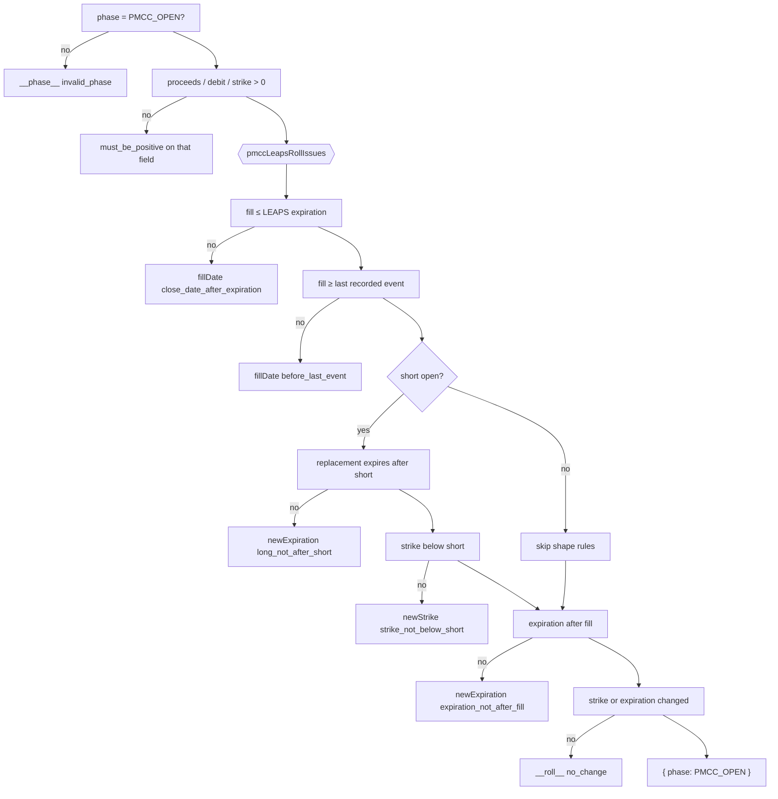

# US-105 — Roll the PMCC LEAPS to a further expiration when DTE is low

Adds the PMCC LEAPS roll. A pure `rollPmccLeaps` rule set checks that the replacement LEAPS is a
legal successor that still covers the open short call. A service writes the **inverted** linked pair
(`ROLL_FROM` SELL the current LEAPS, `ROLL_TO` BUY the replacement) and US-103's `PMCC_LEAPS_ROLL`
snapshot in one transaction, through a writer now shared with US-104's short-call roll. A new
`positions:roll-pmcc-leaps` channel carries the request. A `Roll LEAPS` sheet shows a coverage
ruler, a live net debit/credit preview, the post-roll basis, LEAPS cost to date and the re-anchored
effective share cost, and two advisory notes. The positions list now shows a PMCC's open legs, so it
follows rolls and expiries. The classic wheel is unchanged.

Plan: `plans/us-105/plan.md` · Story: Linear
[OPT-13](https://linear.app/optionswheel/issue/OPT-13/us-105-roll-the-pmcc-leaps-to-a-further-expiration-when-dte-is-low) ·
Type design: `plans/us-105/data-model.md` · Contract: `plans/us-105/contracts/positions-roll-pmcc-leaps.md` ·
Layout of record: `mockups/epic-09-pmcc-position-detail.mdx` (`RollLeapsSheet`) · Spec:
[`docs/spec/features/us-105-roll-pmcc-leaps.md`](spec/features/us-105-roll-pmcc-leaps.md)

## Why

A LEAPS loses time value fast in its last few months. A PMCC trader rolls it before then: sell the
current LEAPS, buy one further out (often at a different strike), and keep the short call covered.
The net cash of the pair moves the running cost basis, and the new strike moves the effective share
cost if the trader is ever exercised. Before this story the only way to record that was US-103's
test seam. Now the trader enters the proceeds and the replacement, sees the net and its effect on
basis and effective cost before confirming, and the app stores the roll as one linked pair and one
ledger line. Two kinds of mistake are stopped: a replacement that would leave the open short call
uncovered (expiring on or before it, or striking at or above it) and a "roll" that changes nothing.

## Behaviour

- **Entry point.** A `Roll LEAPS →` header action (`roll-pmcc-leaps-btn`) appears on any PMCC
  detail page with an open LEAPS, after `Roll Short Call →` when a short is open and on its own when
  none is. A wheel never shows it.
- **Context.** The sheet opens with `Coverage` (today, the open short, the current LEAPS and the
  replacement on one axis), `Current LEAPS` (contract, expiration with DTE, `Bought at`, `LEAPS cost
to date`, `Cost basis`, highlighted `Effective share cost` and a note that it re-anchors to the
  replacement strike) and `Open short call` (read-only, or `No short call open — nothing to cover,
so the expiration and strike checks are skipped.`).
- **Inputs.** Proceeds from close / share, debit (buy to open) / share, strike (pre-filled with the
  current strike), expiration with a live `N DTE` hint, and fill date (defaults to today).
  Contracts are read-only.
- **Live preview.** Until both cash fields parse, a dashed placeholder reads `Enter the proceeds
from close and the replacement debit to preview the net.` After that the `Net` card shows `Net
Credit: $2.50 per share ($250.00 total)` in green or `Net Debit: $3.20 per share ($320.00 total)`
  in red (`Net Even:` in grey when the cash nets to zero), the year-bearing roll label (`Roll Up & Out: $80 to $85 strike, Sep 2027 to Jan 2028
expiration · 196 DTE`; `Roll In` for an earlier replacement), and `Cost basis after roll`, `LEAPS
cost to date after` and `Effective share cost after roll` with their "from" figures and a note such
  as `$85.00 strike + $19.30 basis · up $2.50 from $101.80.` The card closes with one sentence: a
  debit reads `You are buying time value; it lands in the basis.`, a credit at the same or a lower
  strike `Cash came out; it lowers the basis.`, a credit at a higher strike `Cash came out, but the
  strike moved up more than the credit.`, and an even roll `No net cash changed hands.`
- **Advisories (never block).** A warning appears when the post-roll effective share cost rises
  above the open short strike (`Open short strike $112.00 is below your effective share cost of
$112.80 after this roll. If assigned, covering from the LEAPS realizes roughly $0.80 per share of
  loss.` — exactly the AC sentence). An info note appears when the replacement shortens coverage but
  still outlasts the short (`Replacement LEAPS is 42 DTE, 28 days shorter than the current LEAPS. It
still covers the open short call.`). A debit roll is normal and keeps confirm enabled.
- **Rejections.** Each message appears next to its field (or in the no-change alert) and confirm is
  disabled. A fill date before the position's last recorded event is rejected with that event's
  date. When the replacement does not outlast the short, the ruler turns red; for that or a
  strike at/above the short, the footer says the current LEAPS stays open. The same rules run again
  in the engine, so a direct IPC call is rejected with the same text.
- **Success.** The sheet closes. A `pmcc-leaps-roll-recorded-banner` names both legs and the ledger
  line — `LEAPS roll #1 credit · $2.50 per share ($250.00 total). Both legs share one roll chain.` —
  and `Effective share cost if exercised: $104.30 — the $85.00 strike plus $19.30 basis.` The detail
  refetches: the drawer reads $19.30 / LEAPS cost to date $22.50 / $104.30, the leg reference shows
  the $85 LEAPS and the unchanged $112 short.
- **Positions list.** The PMCC row now shows the open legs, so after this roll it reads `$85.00 /
$112.00`; with no short open it reads `$80.00 / No short open` and still sorts by the LEAPS' DTE
  (follow-up US-123 / OPT-29 will raise a `NO_SHORT_OPEN` alert and sort such a row as DTE 0).
- **Wheel unaffected.** `rollCc`, `RollCcSheet` and `roll-cc-btn` are unchanged; an e2e regression
  confirms the CC roll sheet has no LEAPS or effective-cost content.

## The rule set

`rollPmccLeaps` in `src/main/core/lifecycle.ts` checks ten rules in a fixed order. The first failure
throws `ValidationError(field, code, message)`.

| #   | Rule                                      | field                         | code                          | Where               |
| --- | ----------------------------------------- | ----------------------------- | ----------------------------- | ------------------- |
| 1   | phase is `PMCC_OPEN`                      | `__phase__`                   | `invalid_phase`               | engine              |
| 2   | proceeds > 0                              | `proceedsPerContract`         | `must_be_positive`            | engine (form: Zod)  |
| 3   | replacement debit > 0                     | `replacementDebitPerContract` | `must_be_positive`            | engine (form: Zod)  |
| 4   | new strike > 0                            | `newStrike`                   | `must_be_positive`            | engine (form: Zod)  |
| 5   | roll fill ≤ current LEAPS' expiration     | `fillDate`                    | `close_date_after_expiration` | shared list         |
| 6   | roll fill ≥ the last recorded event       | `fillDate`                    | `before_last_event`           | shared list         |
| 7   | replacement expires after the open short  | `newExpiration`               | `long_not_after_short`        | shared list (short) |
| 8   | replacement strike below the open short   | `newStrike`                   | `strike_not_below_short`      | shared list (short) |
| 9   | replacement expires after the roll fill   | `newExpiration`               | `expiration_not_after_fill`   | shared list         |
| 10  | strike or expiration changes (Decimal eq) | `__roll__`                    | `no_change`                   | shared list         |

Rules 5–10 are one ordered pure list, `pmccLeapsRollIssues` in `src/main/core/pmcc-rules.ts`. Rule
6 compares the fill date with `lastEventDate`, the latest fill date among the position's legs from
the pure `latestFillDate(legs)`; its message names that date: `Fill date cannot be before the last
recorded event (Jul 9, 2027)`. The last event is never before the LEAPS' own fill, so rule 6 also
keeps the roll after the LEAPS it sells; the LEAPS roll has no `close_date_before_open` rule. The
engine throws the first issue it returns; the renderer's `rollPmccLeapsSchema(ctx)` calls the same
function in `superRefine` and reports the first issue per path, passing an undecided date or strike
as `undefined` so its rule is skipped. Rules 7 and 8 (marked "short") are skipped when no short call
is open. There is deliberately **no** "on or after the current expiration" rule.



Shared constants keep the text in one place: `LONG_NOT_AFTER_SHORT` is the long-side message of
US-102's comparator — the same `shortExpiresBeforeLeaps` predicate as `SHORT_NOT_BEFORE_LONG`,
called with the arguments swapped; `shortStrikeAboveLeaps` now also backs `pmccCrossLegIssues`'s
entry rule; `leapsStrikeNotBelowShortMessage` formats `($112.00)`; `ROLL_NO_CHANGE` and
`EXPIRATION_NOT_AFTER_FILL` are shared with the short-call roll.

## What changed

### Core — `src/main/core/`

| File                 | Change                                                                                                                                                                                                                                                                                                                                                                                                       |
| -------------------- | ------------------------------------------------------------------------------------------------------------------------------------------------------------------------------------------------------------------------------------------------------------------------------------------------------------------------------------------------------------------------------------------------------------ |
| `pmcc-rules.ts`      | `pmccLeapsRollIssues`, `PmccLeapsRollContext` / `Input` / `Field`; `LONG_NOT_AFTER_SHORT` grouped with `SHORT_NOT_BEFORE_LONG` under a US-102 comparator block; `shortStrikeAboveLeaps` (now used by `pmccCrossLegIssues`); `STRIKE_NOT_BELOW_SHORT_CODE`, `leapsStrikeNotBelowShortMessage`; `ROLL_NO_CHANGE` (now used by `pmccShortRollIssues`); `latestFillDate(legs)` and the `before_last_event` rule. |
| `lifecycle.ts`       | `rollPmccLeaps`, `RollPmccLeapsInput` (with `lastEventDate`) / `RollPmccLeapsAccepted`; US-104's engine result renamed `RollPmccShortCallAccepted`, so neither clashes with the IPC result types in `schemas.ts`; new `PmccLegTerms` and `PmccFilledLegTerms` (`PmccShortCallTerms` is now an alias of the latter).                                                                                          |
| `costbasis.ts`       | `PmccLedgerWithStrike` (`PmccLedgerResult` with a non-null `effectiveShareCost`), returned by the `calculatePmccLedger` overload that takes a `longStrike`.                                                                                                                                                                                                                                                  |
| `position-order.ts`  | A PMCC with no open short orders by its LEAPS DTE: `(pmcc.short ?? pmcc.long).dte` (US-123 will change this to DTE 0).                                                                                                                                                                                                                                                                                       |
| `*.property.test.ts` | `rollPmccLeaps` joins the phase-guard table; coverage, strike, no-short-skip and valid-input properties; `shortStrikeAboveLeaps` and the LEAPS roll's fill-date / replacement-expiry rules in `pmcc-rules.property.test.ts`.                                                                                                                                                                                 |

### Services — `src/main/services/`

| File                               | Change                                                                                                                                                                                                                                                                                                                                                                                                                                            |
| ---------------------------------- | ------------------------------------------------------------------------------------------------------------------------------------------------------------------------------------------------------------------------------------------------------------------------------------------------------------------------------------------------------------------------------------------------------------------------------------------------- |
| `roll-pmcc-leaps-position.ts`      | **New.** `loadPmccRollContext` → `money4`, `newStrike` defaulting to the LEAPS strike, `lastEventDate = latestFillDate(detail.legs)` → `rollPmccLeaps` → `recordPmccRoll` (SELL the LEAPS @ proceeds, BUY the replacement @ debit, `PMCC_LEAPS_ROLL`). Returns `nextPmccRollNumber(legs, 'leaps')`; wrapped in `logPmccRollRejection`.                                                                                                            |
| `pmcc-roll-record.ts`              | **New, shared.** `requirePmccOpenLegs(detail)` (phase reported before a missing LEAPS), `loadPmccRollContext(db, positionId)` (`not_found` / phase / no-leg, returns `{ detail, openLegs }`), `logPmccRollRejection(positionId, event, roll)` (INFO on a `ValidationError`, rethrown) and `recordPmccRoll(db, positionId, { from, to, contracts, fillDate, triggerEvent })`: one `db.transaction` with two `insertLegRow` + `appendPmccSnapshot`. |
| `pmcc-ledger.ts`                   | `nextPmccRollNumber(legs, 'short' \| 'leaps')` numbers both PMCC rolls; `pmccLedgerFromLegs` and `AppendPmccSnapshotResult.ledger` are typed `PmccLedgerWithStrike`.                                                                                                                                                                                                                                                                              |
| `leg-rows.ts`                      | `money4` (4-dp TEXT) moved here; used by both PMCC roll services and `create-pmcc-position.ts`.                                                                                                                                                                                                                                                                                                                                                   |
| `roll-pmcc-short-call-position.ts` | Now calls `loadPmccRollContext`, `logPmccRollRejection`, `recordPmccRoll` and `nextPmccRollNumber(legs, 'short')`; its private guard and transaction body are gone. Its tx debug logs became the shared `pmcc_roll_tx_start` / `pmcc_roll_tx_committed`.                                                                                                                                                                                          |
| `list-positions.ts`                | PMCC leg summaries come from `pmccOpenLegs(legs)` (roll- and expiry-aware); `short` may be `null`.                                                                                                                                                                                                                                                                                                                                                |
| `pmcc-opening-legs.ts`             | `pmccOpeningLegs` ("later rows win", rolls not consulted) removed; `pmccEntryLegs` / `pmccInitialNetDebit` remain for the entry net debit.                                                                                                                                                                                                                                                                                                        |
| `test-fixtures/pmcc-legs.ts`       | `EXPIRE_2` (the $112 short expires) for the no-short Background.                                                                                                                                                                                                                                                                                                                                                                                  |

### Schemas, IPC, preload

- `src/main/schemas.ts`: `RollPmccLeapsPayloadSchema` (its own `z.object`: `proceedsPerContract`,
  `replacementDebitPerContract`, `newExpiration`, optional `newStrike`, ISO-checked optional
  `fillDate`). New `RollLegPair<From, To>`; `RollResultBase<Phase, From, To>` extends it, defaults
  `BUY` / `SELL`. `RollPmccLeapsResult extends RollResultBase<'PMCC_OPEN', 'SELL', 'BUY'>` with a
  narrowed snapshot, `ledger: PmccLedgerWithStrike` and `leapsRollNumber`. `PmccListSummary.short` is nullable.
- `src/main/ipc/positions.ts`: one `registerParsedPositionHandler` for `positions:roll-pmcc-leaps`.
- `src/preload/index.ts` / `index.d.ts`: `rollPmccLeaps`, `IpcRollPmccLeapsResult`.

### Renderer

| Layer      | Files                                                                                                                                                                                                                                                                                                                                                                                                                                                                                                                                                                                                                                                                                                                                                                                                                                                                                                                                                                                                                                                                                                                              |
| ---------- | ---------------------------------------------------------------------------------------------------------------------------------------------------------------------------------------------------------------------------------------------------------------------------------------------------------------------------------------------------------------------------------------------------------------------------------------------------------------------------------------------------------------------------------------------------------------------------------------------------------------------------------------------------------------------------------------------------------------------------------------------------------------------------------------------------------------------------------------------------------------------------------------------------------------------------------------------------------------------------------------------------------------------------------------------------------------------------------------------------------------------------------- |
| api        | `api/positions.ts`: `rollPmccLeaps`, `RollPmccLeapsPayload` / `Response` (`IpcPayload` / `IpcSuccess`).                                                                                                                                                                                                                                                                                                                                                                                                                                                                                                                                                                                                                                                                                                                                                                                                                                                                                                                                                                                                                            |
| hooks      | **New:** `useRollPmccLeaps` (over `usePositionMutation`), `useRollPmccLeapsForm({ leaps, openShort, lastEventDate }, today)` (RHF, `mode: 'onChange'`, returns `{ methods, schema }`), and the shared `useRollSheetSubmit` (single-flight submit + `applyIpcFieldErrors` routing) now used by both PMCC roll sheets.                                                                                                                                                                                                                                                                                                                                                                                                                                                                                                                                                                                                                                                                                                                                                                                                               |
| lib        | `pmcc-roll.ts`: `pmccRollNet` / `pmccRecordedRollNet` take `{ received, paid, contracts }` and return the signed `Decimal` net with grouped totals; `pmccRollLabel(current, next, monthFormat)` with `'MMM yyyy'` and an `In` direction; new `pmccLeapsPostRoll` (runs `calculatePmccLedger` with the LEAPS cost, the short credits and the roll's net as a LONG contribution), `effectiveCostMove`, `leapsCoverageChange`, and `pmccLeapsLedger(ledger)`, which narrows the detail's `pmccLedger` to one with a known effective share cost (or `null`) for both PMCC sheet mounts. **New** `pmcc-leaps-roll-view.ts`: pure `leapsRollView(values, ctx)` derives everything the form renders (validity, DTEs, net, post-roll, shortfall, label, coverage change, whether the LEAPS stays open). **New** `pmcc-roll-coverage.ts`: `shortRollCoverage` / `leapsRollCoverage` return a `PmccRollCoverage` (`blocked`, `fillTo`, `PmccRulerMark[]` with a `PmccRulerTone`, `note`). **New** `pmcc-roll-recorded.ts`: the `PmccRecordedRoll` union. `ipc-field-errors.ts` exports its routing type and a `showUnplacedMessages` option. |
| schemas    | **New** `roll-pmcc-leaps.ts` (`rollPmccLeapsSchema(ctx)` over `pmccLeapsRollIssues`, ctx `{ currentLeaps, openShort, lastEventDate }`, defaults, `toRollPmccLeapsPayload`). `common.ts` gains `decidedDate`, used by both PMCC roll schemas and the entry schema.                                                                                                                                                                                                                                                                                                                                                                                                                                                                                                                                                                                                                                                                                                                                                                                                                                                                  |
| components | **New:** `RollPmccLeapsSheet` (requires `lastEventDate`), `RollPmccLeapsForm`, `RollPmccLeapsFields`, `RollPmccLeapsNetPreview`, the shared `PmccRollSheetDialog` (portal, dialog, focus, Escape / scrim) and the shared `PmccRollFields` grid (strike, expiration with DTE, fill date, read-only contracts, the two named cash inputs; owns the RHF `deps` re-checks). Changed: `PmccCoverageRuler` takes a `PmccRollCoverage` plus `today`; `RollPmccShortCallSheet` / `Form` use the shared dialog, fields, submit hook and ruler builder; `PmccRollRecordedBanner({ recorded })` renders both roll kinds; `PositionDetailActions` (`Roll LEAPS →`); `PmccPositionRow` (`$80.00 / No short open`).                                                                                                                                                                                                                                                                                                                                                                                                                              |
| pages      | `usePositionDetailSheets`: one `RollSheet` slot (`'csp' \| 'cc' \| 'pmccShort' \| 'pmccLeaps' \| null`) replaces three booleans, and one `PmccRecordedRoll \| null` banner. `PositionDetailPage` mounts the LEAPS sheet only when `pmccLeapsLedger(pmccLedger)` is non-null, passes `lastEventDate={latestFillDate(legs)}` and `hasOpenLeaps`.                                                                                                                                                                                                                                                                                                                                                                                                                                                                                                                                                                                                                                                                                                                                                                                     |

### E2E — `e2e/`

`pmcc-leaps-roll.spec.ts` has one `it` per Linear scenario and Scenario Outline row (15 in total).
`pmcc-roll-helpers.ts` gains the LEAPS Background (`EXPIRE_1` + `SHORT_2` + `SHORT_ROLL` through the
US-103 seam: $112 short at $2.40 over the $80 LEAPS, basis $21.80), the no-short Background (plus
`EXPIRE_2`, added to `pmcc-ledger-helpers.ts`), sheet openers/fillers and run-day-relative date
constants. `helpers.ts`'s `selectDate` now pages up to 36 months, since the too-much-time
replacement sits about 28 months out. The existing PMCC, `cc-roll` and cockpit
specs pass unchanged.

## Data flow

```mermaid
sequenceDiagram
    participant Sheet as RollPmccLeapsSheet
    participant Submit as useRollSheetSubmit
    participant Hook as useRollPmccLeaps
    participant IPC as positions:roll-pmcc-leaps<br/>(handleIpcCall + Zod)
    participant Svc as rollPmccLeapsPosition
    participant Engine as rollPmccLeaps<br/>+ pmccLeapsRollIssues (pure)
    participant Rec as recordPmccRoll<br/>(shared with short roll)
    participant Tx as db.transaction
    participant Writer as appendPmccSnapshot

    Sheet->>Submit: confirm (schema.safeParse ok)
    Submit->>Hook: mutate(toRollPmccLeapsPayload(values))
    Hook->>IPC: window.api.rollPmccLeaps(payload)
    IPC->>Svc: parsed payload
    Svc->>Svc: loadPmccRollContext → {detail, long, short|null}; lastEventDate = latestFillDate(legs)
    Svc->>Engine: phase, currentLeaps, openShort, lastEventDate, fill, new terms (4 dp)
    Engine-->>Svc: { phase: PMCC_OPEN } or ValidationError
    Svc->>Rec: from SELL LEAPS @ proceeds, to BUY replacement @ debit, PMCC_LEAPS_ROLL
    Rec->>Tx: begin (pmcc_roll_tx_start)
    Tx->>Tx: insertLegRow ROLL_FROM (SELL current LEAPS)
    Tx->>Tx: insertLegRow ROLL_TO (BUY replacement)
    Tx->>Writer: triggerEvent PMCC_LEAPS_ROLL, eventDate = fillDate
    Writer-->>Tx: { ledger, snapshot } (basis re-derived from all legs)
    Tx-->>Rec: commit (or roll back both legs and the snapshot)
    Rec-->>Svc: legs, rollChainId, ledger, snapshot (pmcc_roll_tx_committed)
    Svc-->>IPC: RollPmccLeapsResult (+ nextPmccRollNumber 'leaps')
    IPC-->>Hook: { ok: true, ...result } | { ok: false, errors }
    Hook-->>Sheet: onSuccess → onRecorded / onError → applyIpcFieldErrors
    Sheet->>Sheet: page closes sheet, shows pmcc-leaps-roll-recorded-banner, detail refetches
```

## Decisions and deviations worth knowing

The implementation wins where it differs from the plan. These came out of TDD and code review:

- **One ordered rule list, with three date rules the plan did not have.** The plan had seven
  engine rules and a form schema that spread individual constants in its own `superRefine`.
  Instead every cross-field rule lives in `pmccLeapsRollIssues`, which both sides consume. It adds:
  roll fill ≤ the current LEAPS' expiration (`Fill date cannot be after the LEAPS expiration date`,
  `close_date_after_expiration`); roll fill ≥ the position's last recorded event (`Fill date cannot
be before the last recorded event (Jul 9, 2027)`, `before_last_event`); and replacement
  expiration > fill date (`EXPIRATION_NOT_AFTER_FILL` — otherwise an expired replacement reads as
  the open LEAPS forever). The last-event rule replaced an earlier `close_date_before_open` check
  against the LEAPS' own fill: a roll back-dated before a later leg (say the short roll) would sort
  before it, leave the latest snapshot stale, and have the shape rules judge today's short rather
  than the one open on the fill date. Since the last event is never before the LEAPS' fill, the new
  rule covers the old one. The engine input therefore carries
  `lastEventDate` (from the pure `latestFillDate(legs)`, also called by `PositionDetailPage` for the
  sheet's new required `lastEventDate` prop) and the roll's `fillDate`; the payload's `fillDate` is
  ISO-checked. The fill-date input declares `deps: 'newExpiration'` so editing it re-checks the
  expiration rule. The short-call roll keeps its own `close_date_before_open` rule.
- **Engine results are `…Accepted`.** `rollPmccLeaps` returns `RollPmccLeapsAccepted` and
  US-104's `rollPmccShortCall` now returns `RollPmccShortCallAccepted`, so the core names no longer
  collide with the IPC result types `RollPmccLeapsResult` / `RollPmccShortCallResult` in
  `schemas.ts`.
- **`PmccLedgerWithStrike`.** `calculatePmccLedger` has an overload that, given a `longStrike`,
  returns a ledger whose `effectiveShareCost` is a string. `pmccLedgerFromLegs`,
  `AppendPmccSnapshotResult.ledger` and `RollPmccLeapsResult.ledger` use it, so the banner reads the
  effective cost without a null check; the renderer's `pmccLeapsLedger()` narrows the detail's
  ledger the same way for both PMCC sheet mounts.
- **More shared names in `pmcc-rules.ts`.** `ROLL_NO_CHANGE` (both PMCC rolls),
  `LONG_NOT_AFTER_SHORT`, `shortStrikeAboveLeaps`, `leapsStrikeNotBelowShortMessage` and
  `STRIKE_NOT_BELOW_SHORT_CODE`.
- **`RollResultBase<Phase, From, To>` extends a new `RollLegPair<From, To>`.** The plan dropped the
  `Phase` parameter US-104 had added; the build kept it and split the pair out, so
  `RollPmccLeapsResult extends RollResultBase<'PMCC_OPEN', 'SELL', 'BUY'>` and the shared writer can
  return `AppendPmccSnapshotResult<T> & RollLegPair<From, To>`.
- **A shared PMCC roll writer.** `src/main/services/pmcc-roll-record.ts` (`recordPmccRoll`,
  `requirePmccOpenLegs`, `loadPmccRollContext`, `logPmccRollRejection`) is used by both PMCC roll
  services, which also share `nextPmccRollNumber` (`pmcc-ledger.ts`) and `money4` (`leg-rows.ts`) — the extraction the plan offered "only
  if both services' tests stay green". Its debug logs are `pmcc_roll_tx_start` /
  `pmcc_roll_tx_committed` with the trigger event.
- **Shared renderer pieces.** `PmccRollSheetDialog`, `PmccRollFields` and `useRollSheetSubmit`
  serve both PMCC roll sheets (the "second copy" US-104 said to wait for). `PmccRollFields` owns the
  RHF `deps` rules, so neither sheet can forget them. The LEAPS form's derived figures come from the
  pure `leapsRollView` (`lib/pmcc-leaps-roll-view.ts`). The coverage ruler is marks-based, with each
  sheet's marks built by pure `shortRollCoverage` / `leapsRollCoverage` in
  `lib/pmcc-roll-coverage.ts`. `pmccRollNet({ received, paid, contracts })` returns the signed
  `Decimal` net. `pmccLeapsPostRoll` gives the post-roll basis, LEAPS cost and re-anchored effective
  cost.
- **One sheet slot, one banner slot.** `usePositionDetailSheets` now holds a single `RollSheet`
  value for all four roll sheets (the plan's optional Refactor) and a `PmccRecordedRoll` union
  (`lib/pmcc-roll-recorded.ts`), so
  two roll sheets or two confirmations cannot show at once. `PmccRollRecordedBanner` renders both
  kinds; the LEAPS banner also names `Effective share cost if exercised: $X — the $S strike plus $B
basis.`
- **The positions list follows the roll.** Not in the plan: once a LEAPS roll is recorded, US-103's
  `pmccOpeningLegs` would keep showing the original `LEAPS_OPEN`. The PMCC list row now derives its
  legs from `pmccOpenLegs` (roll- and expiry-aware), `pmccOpeningLegs` is removed,
  `PmccListSummary.short` is nullable, and a no-short row reads `$80.00 / No short open` and is ordered by LEAPS
  DTE in `position-order.ts`. Follow-up US-123 (Linear OPT-29) adds a `NO_SHORT_OPEN` alert and
  sorts a no-short PMCC as DTE 0.
- **Smaller choices.** Both PMCC roll sheets route with `showUnplacedMessages: true`: a server
  error with no form field (`__root__` / `__phase__`, e.g. `not_found`) shows its own message in the
  save alert; a failure with no field errors shows the generic save message. The replacement's DTE in
  the shortened-coverage note is only shown once the expiration parses, so it never reads `null`.
  Confirm is gated on `schema.safeParse`, not RHF `isValid` (US-104's convention). The strike is
  pre-filled with the current LEAPS strike at 2 dp. Money crosses the IPC as numbers.

## Out of scope and follow-ups

- **History line → US-109.** The AC's "history shows one line 'LEAPS roll #1 credit'" is the
  timeline's job; until US-109 ships, the success banner names that line. The data behind it (one
  chain, one `PMCC_LEAPS_ROLL` snapshot) is what US-109 will read.
- **No fees input.** Roll legs write `fees = '0.0000'`.
- **US-102 may rename `long_not_after_short`.** The constant is the one place to change.
- **No-short PMCC alert and ordering → US-123** (Linear OPT-29): a `NO_SHORT_OPEN` alert, and
  sorting a no-short row as DTE 0 instead of by its LEAPS DTE.
- **Known gaps (both PMCC rolls), left as is by decision:**
  - **No future-date guard on the roll fill date.** Neither roll rejects a fill date after today, so
    a mistyped future date becomes the position's last event and `before_last_event` then blocks
    later LEAPS rolls dated before it. Adding the guard needs the e2e Background re-based to past
    dates or a test clock, because the scenarios record events after the real today.
  - **The short-call roll has no last-event rule.** It only requires a fill on or after the open
    short's fill, so it can be dated before a later LEAPS roll.
- **Not in this story:** the LEAPS DTE alert and any deep link into this sheet (US-107), IVR /
  term-structure context (US-113, US-114), selling a subsequent short (US-115), assignment (US-111),
  closing the PMCC (US-120), the final PMCC header and hero (US-118), chain-driven strike selection,
  broker-executed rolls (Epic 10), partial rolls and editing a recorded roll.

## Verification

- `pnpm test`, `pnpm lint`, `pnpm typecheck` and `pnpm test:e2e` all pass on the final code, including
  all 15 `pmcc-leaps-roll.spec.ts` cases and the unchanged `pmcc-short-call-roll`, `pmcc-cost-basis`,
  `cc-roll`, `open-pmcc-position` and `position-cockpit` specs.
- The worked figures match the AC: up & out 26.00 / 23.50 → basis $19.30, LEAPS cost $22.50,
  effective $104.30; the snapshot chain reads `23.0000, 23.0000, 21.2000, 21.8000, 19.3000`.
