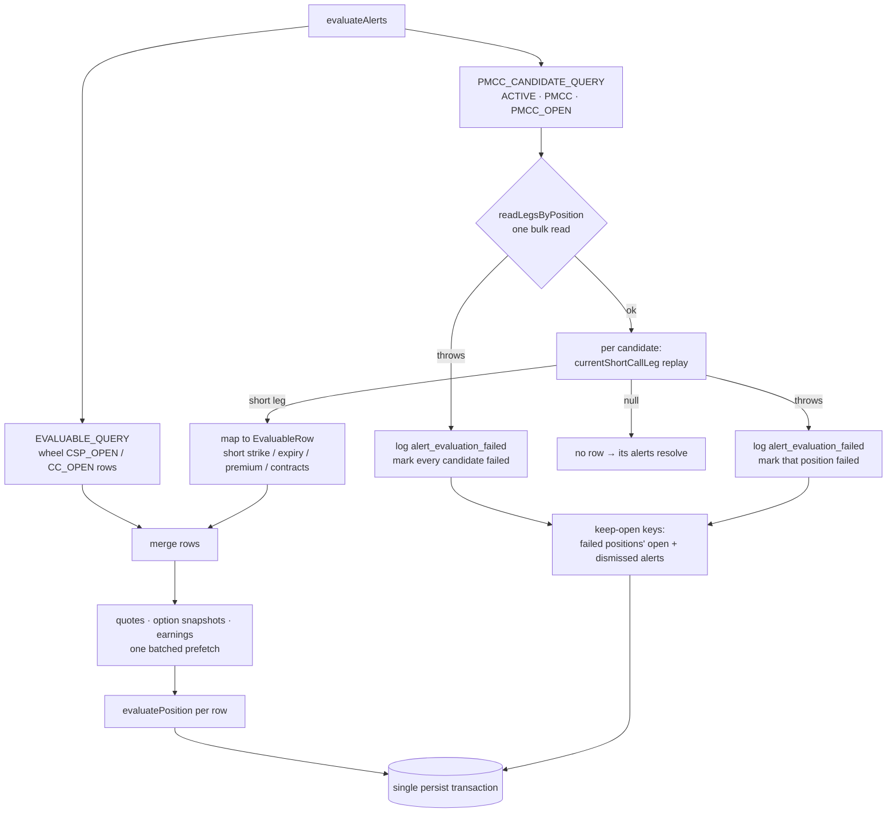

# US-106 — PMCC short-call assignment-risk alert

Adds a medium-urgency `PMCC_ASSIGNMENT_RISK` alert. It opens when the underlying trades
within 2% **below** a PMCC short-call strike, and stays open at any price at or above the
strike. The alert is a floor with no ceiling. Getting there also makes a PMCC evaluable by
the alert engine for the first time, with its **current short call** as the evaluated leg
and never the LEAPS. So the generic short-leg rules (EXPIRATION_IMMINENT,
MANAGEMENT_WINDOW, PROFIT_TARGET, EARNINGS_PROXIMITY) now apply to PMCC short calls too.

Story: [OPT-14](https://linear.app/optionswheel/issue/OPT-14) · Plan: `plans/us-106/plan.md` ·
Selection and type design: `plans/us-106/data-model.md` · Mockup:
`mockups/us-106-pmcc-assignment-risk-alert.mdx`

## Why

A PMCC has no shares to deliver. If its short call is assigned, the LEAPS has to be exercised
or sold to cover, which ends the position. The moment to roll up-and-out therefore comes on
the way **up** to the strike, not at it, and a stock that runs further through the strike
is more exposed, not less. A two-sided band like the CSP rule's (US-55) would wrongly resolve
the alert as the stock ran through the strike.

## What changed

### The rule — `src/main/core/alerts.ts`

One new `RULES` registry entry; the evaluation loop is unchanged.

| Field      | Value                                                                                                                                  |
| ---------- | -------------------------------------------------------------------------------------------------------------------------------------- |
| Code       | `PMCC_ASSIGNMENT_RISK` (appended to `RuleCode`)                                                                                        |
| Phase      | exactly `PMCC_OPEN` — other phases produce neither a match nor a skip                                                                  |
| Predicate  | unrounded signed `(strike − price) / strike × 100 ≤ PMCC_ASSIGNMENT_RISK_MAX_PERCENT_BELOW (2)`                                        |
| Skip guard | shared `priceVsStrikeMissingData('PMCC_OPEN')` → `missing_underlying_price` / `missing_strike`                                         |
| Summary    | `Stock is 1.5% below the $110.00 short-call strike — approaching assignment`, or `… above … — in the money, LEAPS would have to cover` |
| Urgency    | medium; action `Review position`                                                                                                       |

The predicate uses the unrounded value, so a price like 107.7999, which _displays_ as
"2.0% below", stays outside the band. The above/below decision is shared with the CSP rule
through a new `priceDirection` helper. At the money reads "0.0% above".

### Selecting the PMCC short — `src/main/services/evaluate-alerts.ts`

The wheel SQL (`EVALUABLE_QUERY` / `activeLegSubquery`) is untouched. PMCCs take a separate
path:

- `currentShortCallLeg` (from US-103's ledger) follows `SHORT_CALL_OPEN`, short-side roll
  `ROLL_TO`s, and the closing roles. LEAPS rolls never change the selected short.
- A **null** short is a confirmed "no open short call": the position contributes no row, so
  its earlier alerts resolve. A replay **failure** is different. The position's existing
  open and dismissed alerts are kept rather than treated as cleared, and the failure is
  logged with its position id.
- Only the short call's OCC symbol is ever requested; the LEAPS is never fed to the engine.

### Queue badge — `src/renderer/src/components/ManagementQueueRow.tsx`

The badge cell branches on `item.phase === 'PMCC_OPEN'` and renders a gold-dot
`PMCC · short call` badge in place of the wheel `PhaseBadge`. Because the branch keys on
phase, a HIGH expiration-imminent row on a PMCC gets the same badge. The badge column widened
from 110px to 150px to fit the label.

The preload's hand-copied `ManagementQueueItem` (with `phase: string`) is now an alias of the
schema type (`phase: WheelPhase`), which removed an `as WheelPhase` cast.

## Tests

| Layer      | File                                                      | Covers                                                                                                                                                                     |
| ---------- | --------------------------------------------------------- | -------------------------------------------------------------------------------------------------------------------------------------------------------------------------- |
| Core       | `src/main/core/alerts.test.ts`                            | every story price, the 107.7999 rounding guard, skip reasons, phase guard, co-fire                                                                                         |
| Properties | `src/main/core/alerts.property.test.ts`                   | `price×100 ≥ strike×98` oracle, monotonicity, non-PMCC phase guard                                                                                                         |
| Service    | `src/main/services/evaluate-alerts-pmcc.test.ts`          | short-only OCC, generic rules on the short, real short roll, repeated/LEAPS rolls, closing events, lifecycle, missing/rejected quotes, failure isolation, queue enrichment |
| Component  | `src/renderer/src/components/ManagementQueueRow.test.tsx` | PMCC badge, actions, phase-based branch                                                                                                                                    |
| E2E        | `e2e/pmcc-assignment-risk-alert.spec.ts`                  | all nine scenario families from OPT-14 (15 named cases)                                                                                                                    |

## Known gap

When US-106 shipped, nothing in production writes `SHORT_CALL_EXPIRED`, `SHORT_CALL_CLOSE`
or `SHORT_CALL_ASSIGNED`; only the `_test:pmcc-record-leg-event` hook does. A short past
its expiration date therefore stays "current", and the assignment-risk alert can keep
firing while the stock is above the dead strike. This was accepted on purpose: closure
stays ledger-driven, and **US-119** ([OPT-25](https://linear.app/optionswheel/issue/OPT-25),
expiration/close) and **US-111** ([OPT-19](https://linear.app/optionswheel/issue/OPT-19),
assignment) close the gap by writing those legs. The alert service needs no change. Both
issues carry a comment with the follow-up, including switching the S6 e2e from the test
hook to the real path.
