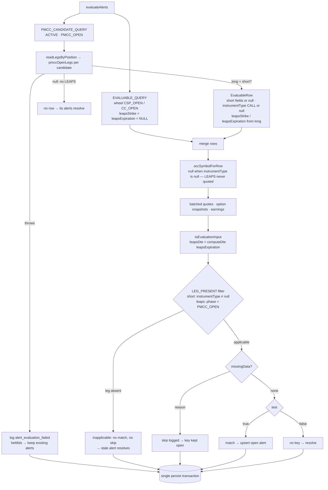
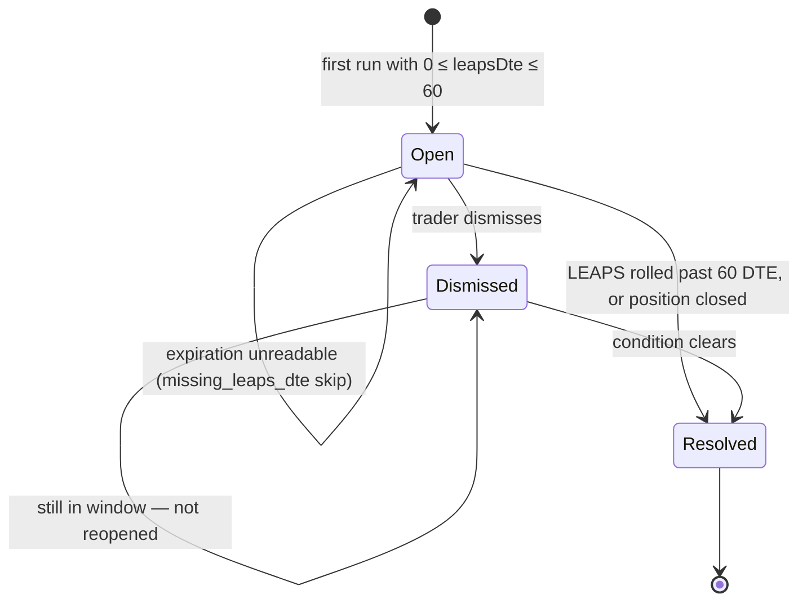

# US-107 — PMCC LEAPS roll-window alert

Adds a medium-urgency `PMCC_LEAPS_ROLL_WINDOW` alert. It opens while a PMCC's LEAPS has
**0–60 calendar days** to expiration, whether or not a short call is open. To make that
possible, every alert rule now declares the leg it reads, and a rule whose leg is absent is
**inapplicable**: it produces neither a match nor a skip. PMCC selection widens from "short
call open" to "LEAPS open". That also fixes a hazard US-106 left behind: on a LEAPS-only
PMCC, `PMCC_ASSIGNMENT_RISK` would have skipped with `missing_strike` and kept a stale
alert open. The queue badge is now leg-aware: `PMCC · LEAPS` or `PMCC · short call`.

Story: [OPT-15](https://linear.app/optionswheel/issue/OPT-15/us-107-fire-alert-when-leaps-dte-drops-below-60-days) ·
Plan: `plans/us-107/plan.md` · Selection and type design: `plans/us-107/data-model.md` ·
Decisions: `plans/us-107/research.md` · Mockup: `mockups/us-107-pmcc-leaps-dte-alert.mdx`

## Why

A PMCC's LEAPS is the collateral for every short call sold against it. As it nears
expiration, it loses time value quickly and can no longer cover a short call that runs past
it. The trader has to roll it out or close the position, and 60 days is the conventional
point to start. The existing rules only ever read the short call. A PMCC whose short had
expired was not evaluated at all, which is exactly when the LEAPS most needs watching.

## What changed

### The rule — `src/main/core/alerts.ts`

One new `RULES` registry entry, plus a leg-applicability filter in front of the loop.

| Field      | Value                                                                                                                   |
| ---------- | ----------------------------------------------------------------------------------------------------------------------- |
| Code       | `PMCC_LEAPS_ROLL_WINDOW` (appended to `RuleCode`)                                                                       |
| Leg        | `leaps`, present iff `phase === 'PMCC_OPEN'`                                                                            |
| Predicate  | `0 ≤ leapsDte ≤ PMCC_LEAPS_ROLL_WINDOW_MAX_DTE (60)`, both ends inclusive                                               |
| Skip guard | `leapsDte === null` → `missing_leaps_dte`; non-numeric `leapsStrike` → `missing_strike`                                 |
| Summary    | `LEAPS expires in 59 days at $80.00 strike — review for roll or close` (also `in 1 day`, `today`)                       |
| Urgency    | medium; action `Review position`                                                                                        |
| Inputs     | two new `AlertEvaluationInput` fields, `leapsDte` and `leapsStrike`, read through `PmccLeapsRollWindowInput` (a `Pick`) |

- **Leg declarations.** `RuleDefinition` gains a required `leg: RuleLeg` (`'short' | 'leaps'`).
  Every existing rule is `leg: 'short'`. `LEG_PRESENT` is an exhaustive
  `Record<RuleLeg, predicate>`: a short is present when `instrumentType !== null`, and a
  LEAPS when the phase is `PMCC_OPEN`. `evaluatePosition` filters `RULES` through it before
  computing skips and matches. An inapplicable rule contributes no key, so its earlier alert
  resolves. A skipped rule contributes a keep-open key. Forgetting `leg` on a future rule is
  a compile error.
- **Shared `inDays` helper.** It renders "today / in 1 day / in N days" for both the
  earnings summary and the LEAPS summary, replacing the earnings rule's inline ternary.
- The LEAPS rule reads only `leapsDte`/`leapsStrike`. The short-leg rules keep reading
  `dte`/`strike`/`expiration`, so the two never read each other's leg.

### Selecting the PMCC — `src/main/services/evaluate-alerts.ts`

`EvaluableRow` gains `leapsStrike` and `leapsExpiration`, and `instrumentType` becomes
nullable. The wheel `EVALUABLE_QUERY` selects `NULL` for both LEAPS columns. In
`loadPmccEvaluableRows`, US-106's `currentShortCallLeg` call is replaced by US-103's
`pmccOpenLegs`, which returns `{ long, short | null }` from one replay:

- **No LEAPS** (`null`): the candidate contributes no row, so its alerts resolve.
- **LEAPS, no short**: the short fields are `null` and `instrumentType: null`, so the
  short-leg rules are inapplicable and only the LEAPS rule runs.
- **Replay throws**: unchanged from US-106. The failure is logged as
  `alert_evaluation_failed`, the position goes into `heldIds`, and its alerts are kept.

`occSymbolForRow` now returns `null` when `instrumentType` is null, so a LEAPS-only PMCC
requests no option snapshot. The LEAPS OCC symbol is never built or quoted.
`toEvaluationInput` sets `leapsDte: computeDte(row.leapsExpiration, now)`. An unreadable
expiration gives `null`, the rule skips with `missing_leaps_dte`, and the open alert keeps
its previous summary.

### Rule code on the queue item — `src/main/schemas.ts`, `src/main/services/alerts.ts`

`ManagementQueueItem` gains `ruleCode: RuleCode`, and `listManagementQueue` selects
`a.rule_code`. The change is additive in `alerts:list` (contract:
`plans/us-107/contracts/alerts-list.md`). The preload's US-106 alias carries the field
through with no edit.

### Leg-aware badge — `src/renderer/src/components/ManagementQueueRow.tsx`

On a `PMCC_OPEN` row, the `PhaseBadge` label comes from `pmccBadgeLabel(item.ruleCode)`. That
gives `PMCC · LEAPS` for `PMCC_LEAPS_ROLL_WINDOW` and `PMCC · short call` for every other
rule. Wheel rows are unchanged.

## Alert lifecycle for this rule

All of this is existing US-50/US-59 behaviour. The rule adds only its trigger and skip.

## Key files

| File                                                 | Change                                                                                                                                              |
| ---------------------------------------------------- | --------------------------------------------------------------------------------------------------------------------------------------------------- |
| `src/main/core/alerts.ts`                            | `PMCC_LEAPS_ROLL_WINDOW` rule, `leapsDte`/`leapsStrike` inputs, `RuleLeg` + `LEG_PRESENT` applicability filter, `leg` on every rule, `inDays`       |
| `src/main/services/evaluate-alerts.ts`               | `pmccOpenLegs` selection (LEAPS open), nullable short fields, LEAPS columns on `EvaluableRow`, `occSymbolForRow` guard, `leapsDte` via `computeDte` |
| `src/main/services/alerts.ts`                        | Queue query and mapper carry `rule_code` → `ruleCode`                                                                                               |
| `src/main/schemas.ts`                                | `ManagementQueueItem.ruleCode: RuleCode`                                                                                                            |
| `src/renderer/src/components/ManagementQueueRow.tsx` | `PMCC_LEG_LABEL` / `pmccBadgeLabel`: `PMCC · LEAPS` vs `PMCC · short call`                                                                          |
| `e2e/pmcc-alert-helpers.ts` (new)                    | Shared harness extracted from US-106's spec: `launch`, `disposeHarness`, `ruleSkips`, `queueRowWith`, `seedMsftCoveredCall`                         |
| `e2e/alert-helpers.ts`                               | `setLegExpiration(dbPath, legId, expiration)`, used to make the LEAPS expiration unreadable                                                         |
| `e2e/pmcc-assignment-risk-alert.spec.ts`             | Uses the extracted harness; its cases are unchanged                                                                                                 |
| `e2e/pmcc-leaps-roll-window-alert.spec.ts` (new)     | All 8 OPT-15 scenario families                                                                                                                      |

## Tests

| Layer      | File                                                              | Covers                                                                                                                                                                                                                                                                                |
| ---------- | ----------------------------------------------------------------- | ------------------------------------------------------------------------------------------------------------------------------------------------------------------------------------------------------------------------------------------------------------------------------------- |
| Core       | `src/main/core/alerts.test.ts`                                    | fires at 60/59/30/2/1/0 with the literal summaries; silent at 61/70/185/−1; `missing_leaps_dte` and `missing_strike` skips; wheel phases neither match nor skip; LEAPS vs short strike; LEAPS-only PMCC gives one match and no skips; wheel `missing_dte` unchanged                   |
| Properties | `src/main/core/alerts.property.test.ts`                           | oracle (fires exactly when `0 ≤ leapsDte ≤ 60`); non-PMCC phase guard; leg independence (short-leg matches and skips unchanged whatever the LEAPS fields hold); inapplicability (a PMCC with no short evaluates only the LEAPS rule)                                                  |
| Service    | `src/main/services/evaluate-alerts-pmcc.test.ts`                  | `PMCC LEAPS roll window (US-107)` block: in-place refresh 60→59, dismissal kept, S4 short expiry (no XYZ option requested), assignment-risk resolves on a LEAPS-only PMCC, S6 co-fire, S5 roll resolves, S7 unreadable keeps the alert open, no-LEAPS candidate, S8 mixed wheel batch |
| Service    | `src/main/services/alerts.test.ts`, `src/main/ipc/alerts.test.ts` | `ruleCode` on queue items, ordering kept; `alerts:list` passes it through                                                                                                                                                                                                             |
| Component  | `src/renderer/src/components/ManagementQueueRow.test.tsx`         | `PMCC · LEAPS` for the LEAPS row, `PMCC · short call` for a HIGH short row (plus `ruleCode` fixtures in three sibling renderer tests)                                                                                                                                                 |
| E2E        | `e2e/pmcc-leaps-roll-window-alert.spec.ts`                        | 12 named cases, listed below                                                                                                                                                                                                                                                          |

The 12 e2e cases, one per scenario outline example:

1. Alert fires once the LEAPS has 60 days or fewer to expiration: 60, 59 and 30 days (3)
2. Alert does not fire while the LEAPS has more than 60 days left: 61 and 70 days (2),
   each with a sibling-CSP positive control
3. The queue row identifies the position as a PMCC and the LEAPS as the leg
4. A PMCC with only the LEAPS open is still evaluated for this rule
5. Alert resolves when the LEAPS is rolled out past the window
6. The short-call rules and the LEAPS rule co-fire without reading each other's leg
7. A LEAPS with no readable expiration keeps the alert open instead of resolving it
8. Classic wheel positions do not use the PMCC rule: MSFT `CC_OPEN` and AAPL `CSP_OPEN` (2)

## Verification

| Gate                     | Result                                                                                           |
| ------------------------ | ------------------------------------------------------------------------------------------------ |
| Vitest                   | 4735 passed                                                                                      |
| E2E                      | 506 passed (1 pre-existing todo)                                                                 |
| Coverage (changed files) | `core/alerts.ts` 98.82% lines / 97.33% branches; every other changed file 100 / 100 (gate ≥ 95%) |
| Mutation (Stryker)       | 3 survivors on changed lines, all killed; 1 equivalent mutant disabled in source                 |

Stryker reported three survivors with `tests=0`: `alerts.ts:300` and `:337`
(`leg: 'short'` → `''`) and `:390` (`&&` → `||`). Applying each mutant by hand failed
110, 110 and 5 tests respectively, so all three are killed. The `input.leapsDte !== null`
conjunct in the rule's `test` is equivalent, because `missingData` skips a null `leapsDte`
before `test` runs and the conjunct only narrows the type. It is marked
`// Stryker disable next-line ConditionalExpression` with that reason.

## Out of scope

From OPT-15: a configurable threshold, escalation tiers,
delta-erosion or other LEAPS-health alerts, modelling auto-exercise of an expiring LEAPS, and
a "roll now" quick action. The alert keeps the registry's `Review position` action. Closing
the LEAPS (`LEAPS_CLOSE`) belongs to US-120. It closes the position, which already removes
it from evaluation.
