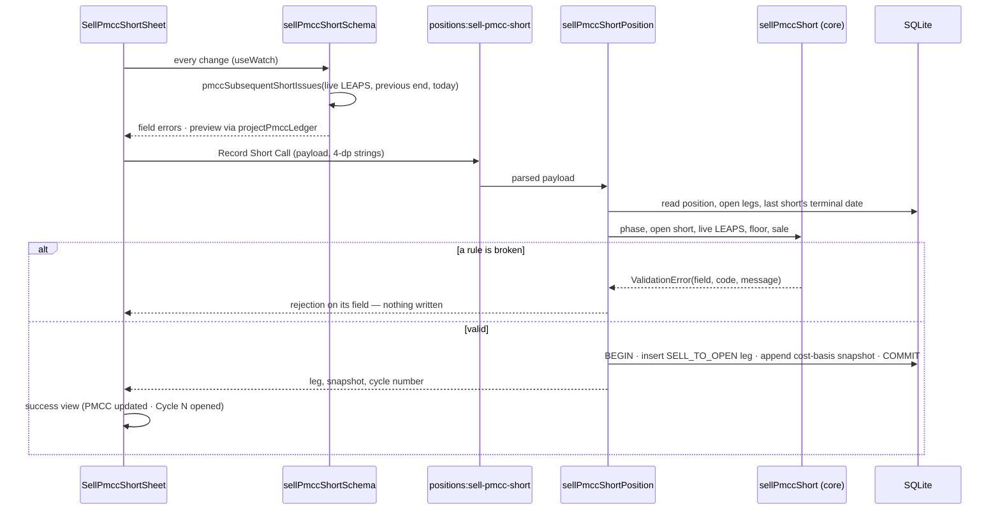
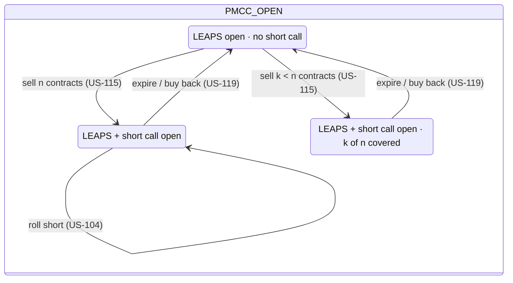

# US-115 — Sell a subsequent short call against an open LEAPS

A PMCC whose last short call has expired or been bought back can now sell the next one from the
position page. **Sell Short Call →** opens a 460px sheet that shows the LEAPS as coverage
context, previews the new cost basis and effective share cost, and records a `SELL_TO_OPEN`
short leg and a cost-basis snapshot in one transaction. Until this story, a PMCC could run
exactly one cycle.

Story: Linear [OPT-23](https://linear.app/optionswheel/issue/OPT-23) · Plan:
`plans/us-115/plan.md` · Types and figures: `plans/us-115/data-model.md` · IPC contract:
`plans/us-115/contracts/`

## Scope

- **In:** the next short call on a `PMCC_OPEN` position with no open short; partial coverage
  (fewer short contracts than LEAPS contracts); the US-102 expiration rule checked against the
  _live_ LEAPS (after a LEAPS roll); the detail header's coverage badge
  (`LEAPS open · no short call`, `LEAPS + short call open`, `… · 1 of 3 covered`).
- **Out:** the first short (US-101), rolling an open short (US-104), retiring a short (US-119),
  broker orders, more shorts than LEAPS contracts, editing a recorded short.

The phase stays `PMCC_OPEN`: "LEAPS + short call open" and partial coverage are coverage states
derived from the open legs, not phases.

## Behaviour

| Rule                                     | Where it is enforced                                       | Message                                                                        |
| ---------------------------------------- | ---------------------------------------------------------- | ------------------------------------------------------------------------------ |
| No short call already open               | engine guard (`__root__`), and the header hides the action | `This PMCC already has an open short call — roll it instead.`                  |
| `1 ≤ contracts ≤ LEAPS contracts`        | shared rules                                               | `Cannot sell more short calls than LEAPS contracts held (N).`                  |
| Fill not before the previous short ended | shared rules, `pmccFillDateFloor`                          | `Fill date cannot be before the previous short call was retired (YYYY-MM-DD).` |
| Expires before the live LEAPS            | US-102 `shortExpiresBeforeLeaps` / `SHORT_NOT_BEFORE_LONG` | `Short call must expire before the LEAPS call.`                                |
| Strike above the LEAPS strike            | US-101's extracted strike rule                             | `Short-call strike must be above the LEAPS strike.`                            |
| Strike below the effective share cost    | advisory only; US-104's `shortfallWarningText('sale')`     | `Short strike $X is below your effective share cost of $Y after this sale. …`  |

The form and the engine run the same rule list (`pmccSubsequentShortIssues`), so the sheet
rejects before the IPC round-trip with the engine's own text on the same field, and the service
stays the authority: a request that bypasses the sheet is judged against the LEAPS read from the
position's open legs, never a renderer-supplied value.

## Key files

**Main process**

- `src/main/core/pmcc-rules.ts` — `pmccSubsequentShortIssues` (the shared rule list),
  `pmccFillDateFloor`, and the US-101 strike rule extracted for reuse.
- `src/main/core/lifecycle.ts` — pure `sellPmccShort(input)`: phase and open-short guards, then
  the shared rules; throws the first issue on its field.
- `src/main/core/costbasis.ts` — `projectPmccLedger`, the ledger after a projected leg, from the
  existing totals; the preview and the snapshot both use it.
- `src/main/services/sell-pmcc-short-position.ts` — reads the live LEAPS and the previous short's
  terminal date (`lastShortRetiredOn`), calls the engine, then writes the leg and the snapshot in
  one transaction.
- `src/main/ipc/positions.ts`, `src/main/schemas.ts`, `src/preload/*` —
  `positions:sell-pmcc-short` with `SellPmccShortPayloadSchema` (4-dp money strings).

**Renderer**

- `components/PmccLegSection.tsx` — US-101's **Sell short call** section, extracted so both the
  entry form and this sheet render it. Its props are a `form: 'entry' | 'sell'` union: the sell
  variant fixes `leg` to `'short'` and requires the underlying and the LEAPS bounds.
- `components/SellPmccShortSheet.tsx`, `SellPmccShortForm.tsx`, `SellShortCoverageCard.tsx`,
  `SellPmccShortPreview.tsx`, `SellPmccShortSuccess.tsx` — the sheet, its form, the coverage card,
  the live `After this sale` card and the success view.
- `schemas/sell-pmcc-short.ts` — the form schema built per LEAPS, and `SELL_SHORT_FORM_FIELDS`,
  the one checked map from engine fields to form paths (used by the schema's cross-field rules and
  by server error routing).
- `lib/pmcc-sell-short.ts` — the preview's figures and the previous-cycle line.
- `lib/pmcc-coverage.ts` — `pmccCoverageLabel`, shared by the detail header and the US-108 card.
- `components/PositionDetailActions.tsx`, `pages/PositionDetailPage.tsx`,
  `pages/usePositionDetailSheets.ts` — the header action and badge, and the sheet's slot. The
  sheet stays open on its success view after its own sale, although the refetched position no
  longer offers the action.
- `lib/ipc-field-errors.ts` — with `showUnplacedMessages`, an `internal_error` keeps the sheet's
  save-failed copy; every other unplaced rejection shows its own message.

**Tests:** engine example and property tests, service and IPC tests through a real database,
renderer tests for the preview, the advisory, the disabled confirm and manual entry, and
`e2e/pmcc-sell-short.spec.ts` — one test per scenario (20 with outline rows).

## Flow

